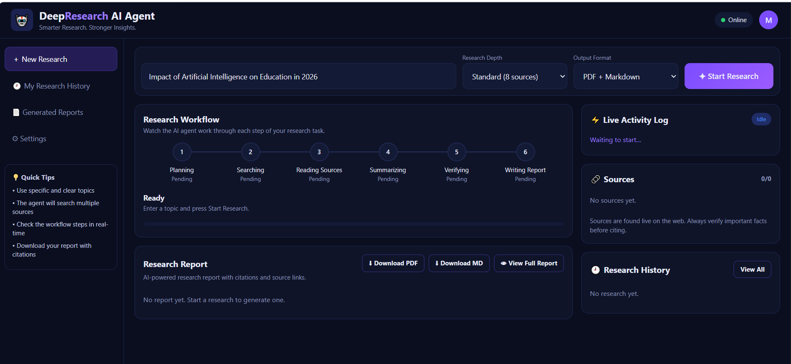
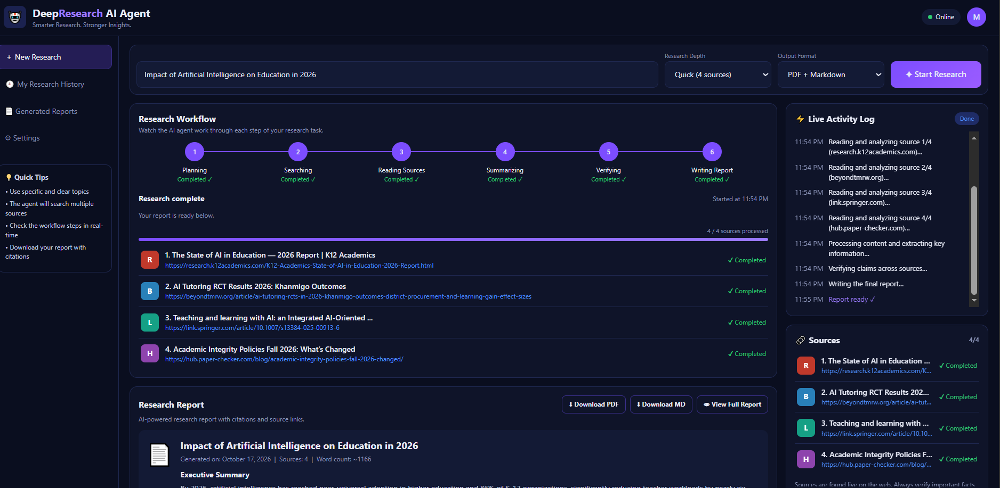
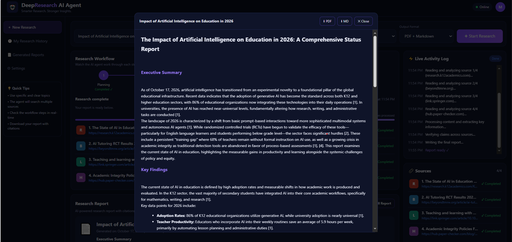
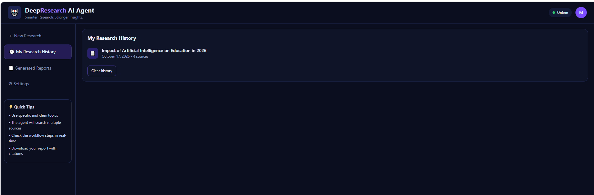

# 🤖 **DeepResearch AI Agent**

**Smarter Research. Stronger Insights.**

An AI research assistant with a live dashboard that **plans, searches, reads, verifies, and writes cited reports** automatically.





---

## ✨ **Features**

- 🧠 **AI-powered research** using Google Gemini
- 🔎 **Free web search** via DuckDuckGo (no API key required)
- 🔄 **Six-stage workflow** with a real-time activity log (SSE)
- 🕘 **Research history** stored in a local SQLite database
- 📥 **Download reports** in **PDF** and **Markdown** with citations
- 🌙 **Modern dark-themed dashboard**
- 💸 **100% free to run**, no credit card needed

---

## 📸 **Screenshots**

| **Research Complete** | **Full Report** |
|---|---|
|  |  |

| **Research History** | **Generated Reports** |
|---|---|
|  |  |

---

## 🔄 **How It Works**

**Planning → Searching → Reading → Summarizing → Verifying → Writing**

1. **Planning:** Gemini generates 7 targeted search queries.
2. **Searching:** DuckDuckGo runs the web searches.
3. **Reading:** Each page is downloaded and cleaned with trafilatura, then Gemini writes notes.
4. **Summarizing:** Gemini produces an executive summary.
5. **Verifying:** Claims are cross-checked across sources.
6. **Writing:** The final report is generated with citations.

Progress is streamed live to the dashboard using Server-Sent Events.

---

## 🧰 **Tech Stack**

| **Layer** | **Technology** |
|---|---|
| Backend | FastAPI, Uvicorn |
| AI Model | Google Gemini (free API) |
| Search | DuckDuckGo |
| Extraction | trafilatura |
| Database | SQLite |
| Frontend | HTML, CSS, JavaScript |

---

## 🚀 **Getting Started**

**Requirements:** Python 3.10+ and a free [Gemini API key](https://aistudio.google.com/apikey) (Google account, no credit card).

**1. Clone the repository**

```bash
git clone https://github.com/MariaZafar22/DeepResearch-AI-Agent.git
cd DeepResearch-AI-Agent
```

**2. Create and activate a virtual environment**

```bash
python -m venv venv

# Windows
venv\Scripts\activate

# Mac/Linux
source venv/bin/activate
```

**3. Install dependencies**

```bash
pip install -r requirements.txt
```

**4. Add your API key**

Create a `.env` file in the project root:

```env
GEMINI_API_KEY=your_free_key_here
GEMINI_MODEL=gemini-2.5-flash
```

**5. Run the app**

```bash
uvicorn main:app --reload
```

Open **http://localhost:8000** in your browser. 🎉

---

## 📁 **Project Structure**

```
DeepResearch-AI-Agent/
├── main.py              # Backend and agent pipeline
├── requirements.txt     # Python dependencies
├── .env                 # API key (never commit this)
├── screenshots/         # README images
└── static/
    └── index.html       # Dashboard UI
```

---

## 🛠️ **Troubleshooting**

| **Problem** | **Solution** |
|---|---|
| **API keys missing** | Check your `.env` file and restart the server |
| **Model not found** | Update `GEMINI_MODEL` using the current name on aistudio.google.com |
| **Free limit reached** | Wait a minute, or use **Quick (4 sources)** depth |
| **No search results** | DuckDuckGo may be rate limiting; wait and retry |
| **PDF text broken** | Non-Latin scripts (e.g. Urdu) need a custom font; English and Roman Urdu work fine |

---

## ⚠️ **Disclaimer**

Sources are found live on the web. **Always verify important facts** before citing them.

---

**👩‍💻 Made by [Maria Zafar](https://github.com/MariaZafar22)**

